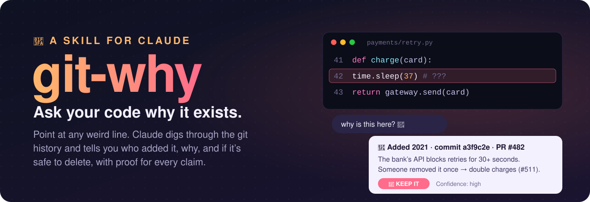
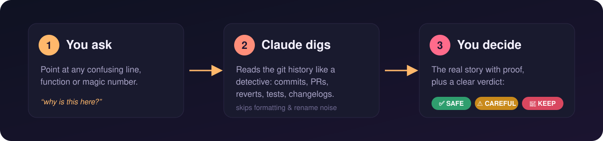

<p align="center">
  
</p>

<p align="center">
  <a href="LICENSE"></a>
  
  
  
</p>

<h3 align="center">Found a weird line of code? Ask <i>why</i> before you delete it.</h3>

---

## 🤔 The problem

Every project has code like this:

```python
time.sleep(37)          # ???
if user.id != 4012:     # don't ask
retries = 3  # was 5
```

You don't know why it's there. The person who wrote it left two years ago. If you delete it, maybe nothing happens, or maybe production breaks at 3 a.m.

**The answer is almost always in the git history.** It's buried in old commits, pull requests and reverts that nobody has time to dig through.

## ✨ What git-why does

**git-why is a skill for Claude that does the digging for you.** Ask in plain English:

> *"why is this `sleep(37)` here? can I remove it?"*

Claude goes through the project's history like a detective and comes back with:

- 📜 **The story:** who added it, when, and *why*
- 🔗 **The proof:** the exact commit, PR or issue for every claim (no guessing)
- 🚦 **A verdict:** ✅ safe to change, ⚠️ be careful, or 🛑 keep it
- 🎯 **A confidence level**, so you know how much to trust the answer

<p align="center">
  
</p>

## 🔍 A real example

We asked git-why about a strange rule in [requests](https://github.com/psf/requests), the most popular Python HTTP library:

> **You:** there's a weird special case in `should_strip_auth` that keeps the password header on http → https redirects. why? can I delete it?

> **git-why:**
> **Short answer:** It's a deliberate compromise from 2018. A security fix (CVE-2018-18074) started removing passwords on redirects, but the maintainers kept this one case so that thousands of existing users wouldn't break.
>
> **Origin:** commit `857e9b7a`, merged in PR #4718, fixing issue #4716.
>
> **Proof:** the PR discussion, the code comment, and a test called `test_should_strip_auth_https_upgrade` that checks exactly this.
>
> **Safe to change?** ⚠️ **Be careful.** Deleting it won't make anything more secure, but it will break people's code and fail a test.
>
> **Confidence:** High

It found all of that in about a minute.

## 🚀 Install (2 minutes)

**1. Download it**

```bash
git clone https://github.com/Haseeb35/git-why.git
```

**2. Give it to Claude**

| Where you use Claude | What to do |
|---|---|
| **Claude Code**, all projects | Copy `git-why/skills/git-why` into `~/.claude/skills/` |
| **Claude Code**, one project | Copy it into `.claude/skills/` inside that project |
| **Claude.ai / desktop app** | Zip the `skills/git-why` folder and upload it in *Settings → Capabilities → Skills* |

**3. Ask a question.** That's it. You don't need to mention git-why. Claude uses it automatically when you ask "why" about code.

**You need:** `git` and Python 3.8+. Optional: the [GitHub CLI](https://cli.github.com) (`gh`), which lets Claude read PR discussions too.

## 💬 Things you can ask

- *"Why is `MAX_RETRIES` set to 7?"*
- *"Who added this `sleep(0.5)` and why?"*
- *"Is it safe to delete `legacy_login()`?"*
- *"What was this commented-out block for?"*
- *"When did the timeout change from 30 to 60?"*
- *"I want to add a `trusted_domains` option. Has anyone tried this before?"*

That last one is a favourite: git-why found that the exact feature had been added *and then reverted* years ago, and explained why.

## 🛡️ Is it safe?

| Question | Answer |
|---|---|
| Will it change my code? | **No.** It only *reads* git history. It never edits files, commits, or switches branches. |
| Does it need an API key? | **No.** It runs inside Claude with your normal git. |
| Does it send my code anywhere new? | **No.** It uses only your local git, plus GitHub if you have `gh` set up. |
| Does it show people's emails? | **No.** Author emails are removed from everything it collects. |
| What if the history doesn't explain it? | It **says so honestly** instead of making up a story. |

## 🧪 Tested, not just vibes

We tested git-why on six tricky real-world questions: magic numbers, deleted code, reverted features, and code hidden behind formatting commits. Each question was asked once with git-why and once without it.

| | With git-why | Without |
|---|---|---|
| Correct, complete answers (smaller model) | **100%** | 83% |
| Clear safe/unsafe verdict with confidence | **every time** | sometimes |

The test cases live in [`skills/git-why/evals/`](skills/git-why/evals) if you want to run them yourself.

## 🧰 Power users: use the digging script directly

The script behind git-why also works on its own, without Claude:

```bash
python skills/git-why/scripts/dig.py src/app.py --lines 120,134
python skills/git-why/scripts/dig.py src/app.py --function retry_upload
python skills/git-why/scripts/dig.py --pattern "LEGACY_AUTH_FALLBACK"
```

It prints an "evidence file": who touched the code, the commit that first added it, the PR it came from, reverts, related files and changelog mentions.

## 📁 What's inside

```
skills/git-why/
├── SKILL.md                    ← the instructions Claude follows
├── scripts/dig.py              ← the history-digging tool (read-only)
├── references/git-techniques.md  ← advanced tricks for hard cases
└── evals/                      ← test questions with expected answers
```

## 🤝 Contributing

Ideas and pull requests are welcome! Some good first contributions:

- Support for GitLab merge requests, Jira or Linear tickets
- Better function detection for more languages
- Share a cool "git-why found this" story in an issue

## 📄 License

MIT. Free to use, change and share.

<p align="center"><sub>Made with 🏺 by <a href="https://github.com/Haseeb35">Haseeb</a>. If git-why saved you from deleting something important, give it a ⭐</sub></p>
